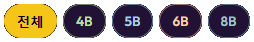
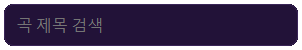
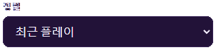
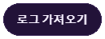
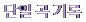
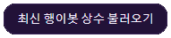

# DrillMAX

**한 곡을 깎을 때, 지금의 폼을 한눈에 보기 위한 로컬 기록 도구**  
for DJMAX RESPECT V

이전 이름은 RhythmForm입니다. 버전별 변경은 [CHANGELOG](./CHANGELOG.md)에 있습니다.

V-ARCHIVE 클라이언트에 표시되는 **로그 텍스트**를 읽어, 공식 갱신에서 버려지는 `[미갱신]` 플레이까지 포함해 로컬에 남깁니다.  
정확도 추이를 그래프로 확인하며 0.01%를 깎는 과정과 결과를 시각적으로 파악할 수 있습니다.


> **Unofficial fan-made tool.** DJMAX RESPECT V 및 관련 상표·저작물의 권리는 (주)네오위즈에 있습니다.  
> 본 프로그램은 네오위즈와 무관한 비공식 팬메이드 도구입니다.

[다운로드 (Releases)](https://github.com/jinthek123/DrillMAX/releases) · [버그·문의 (Issues)](https://github.com/jinthek123/DrillMAX/issues)

---

## 왜 만들었나요

한 곡을 반복해서 깎다 보면 폼이 떨어지는 구간이 생기고, **최고 기록이 아닌 시도**도 쌓입니다.  
그런데 V-ARCHIVE에는 갱신되지 않은(미갱신) 점수나, 최고가 아닌 중간 성과를 한곳에 모아 보기 어렵습니다.

DrillMAX는 그 간극을 메우기 위해 만들었습니다. LIVE로 로그를 따라가며 기록을 남기고, Accuracy / Highest Record 그래프로 **지금의 폼**을 객관적으로 보게 합니다.

※ 사용 시 **V-ARCHIVE 클라이언트**를 켜 두는 것을 권장합니다.

---

## 사용 방법

앱 안의 INFO 탭과 같은 순서입니다. 처음 켜면 V-ARCHIVE Open API 토큰을 넣는 창이 나옵니다. 토큰이 없어도 로그 기록은 가능하고, 예전에 저장해 둔 최고기록은 토큰을 넣어야 불러옵니다.

화면은 왼쪽 **사이드바**와, 오른쪽의 **전체 성과**, **단일 곡 기록**, **행이봇 x DrillMAX**, **INFO** 탭으로 나뉩니다.

### 사이드바


**LIVE** 를 누르면 V-ARCHIVE 로그 수신을 켜거나 끕니다. 글자가 LIVE ON이 되는 조건은 수신을 켠 상태이고, 브리지와 클라이언트가 모두 연결된 경우입니다. 버튼 아래 글자는 꺼짐, 브리지 대기, 클라이언트 미감지, 수신중 중 하나입니다. 닉네임이 있으면 수신중 앞에 닉네임이 붙습니다. ON인 동안 캡쳐·업로드 직후 로그에 남는 `[미갱신]`과 `[성공]` 플레이가 기록됩니다.


**기록 시작**은 노란 세모입니다. 누르면 기록을 시작하고, 켜진 동안에는 세모 대신 깜빡이는 점이 됩니다. 다시 누르면 멈춥니다. 멈춰 있는 동안의 플레이는 나중에 채워 넣지 않습니다. 이 상태는 저장되지 않아서, 앱을 다시 켜면 기록은 꺼져 있습니다.


**라이트** 를 누르면 밝은 화면으로 바뀝니다. 밝은 화면에서는 버튼 글자가 다크로 바뀌고, 그 버튼을 누르면 다시 어두운 화면이 됩니다. 한 번 고른 화면은 다음 실행에도 유지됩니다. 아직 고른 적이 없으면 어두운 화면으로 시작합니다.


**차트 추가** 에서 곡 이름, 버튼, 패턴을 골라 왼쪽 목록에 넣습니다. 곡 이름은 검색할 수 있습니다. LIVE가 켜져 있으면 로그에 새 곡이 나올 때 차트가 생기므로, 미리 넣어 두지 않아도 됩니다.


**API 키 설정** 에 V-ARCHIVE 마이페이지의 Open API 조회 토큰을 저장합니다. 저장하면 그 계정의 기존 최고기록을 불러와 각 차트의 HR로 둡니다. 토큰은 이 PC에만 저장됩니다.


**Update 확인** 은 이 공개 저장소의 최신 설치본을 확인합니다. 지금 설치본보다 새 버전이 있으면 설치 파일을 받습니다. 실험용으로 다른 곳에 올린 파일은 여기서 보이지 않습니다.

### 전체 성과


**전체 성과** 는 넣어 둔 곡을 한 화면에서 비교하는 탭입니다. 카드마다 최근 30일의 일일 최고기록이 선으로 이어집니다. 기록이 없는 날도 선은 끊기지 않습니다. 곡 이름이 날짜와 겹칠 만큼 길면 그 카드의 제목만 작아집니다.


위의 숫자는 왼쪽부터 차트 수, 플레이 수, PP, MC, 99.9% 이상, 99.8% 이상입니다.

- **PP** 는 정확도 100%입니다. Max Combo가 아니어도 100%면 PP입니다.
- **MC** 는 Max Combo이면서 100%가 아닌 플레이입니다.
- 99.9% 기록은 99.8% 개수에도 들어갑니다. 두 기준 모두 그 숫자 이상을 셉니다.



**버튼 필터** 로 전체, 또는 4B, 5B, 6B, 8B만 카드에 보여 줍니다.



**곡 제목 검색** 에 적은 글자가 들어간 곡만 남깁니다.



**정렬** 은 내 순서, 최근 플레이, 가장 오래된 플레이, 플레이 많은 순, 미갱신 많은 순, 이름 중에서 고릅니다. 카드 왼쪽 손잡이를 끌면 다른 카드가 밀려나고, 손을 놓는 자리가 **내 순서**로 저장됩니다. 왼쪽 곡 목록도 그 순서를 따릅니다.



**로그 가져오기** 에 V-ARCHIVE 로그를 붙여 넣으면 그 플레이가 기록에 추가됩니다. 앱을 켜지 못한 채 친 판을 나중에 보완할 때 씁니다. `[미갱신]`과 `[성공]`이 저장됩니다.


**데이터 폴더** 에서 성적이 저장되는 `drillMax.json` 폴더를 바꿉니다. 지정하지 않으면 이 저장소의 `data/drillMax.json`을 사용합니다. 폴더를 바꾸면 그 위치의 파일을 읽고 씁니다.

### 단일 곡 기록



**단일 곡 기록** 은 왼쪽 목록이나 전체 성과 카드에서 고른 곡의 기록과 그래프를 보는 탭입니다.

- **HR** 은 `[미갱신]`을 뺀 최고 정확도입니다. V-ARCHIVE에서 불러온 최고기록이 더 높으면 그 값을 기준으로 합니다.
- **Current** 는 가장 최근 플레이입니다.
- 그래프의 노란 가로선이 HR입니다. 노란 별은 그때의 최고기록이었던 로그에 붙습니다. 나중에 더 높은 기록이 생겨도 그 별은 지워지지 않아서, 최고기록을 세운 날을 남겨 둡니다. 로그로 들어온 판만 별이 됩니다.
- 기록 목록의 BEST 표시는 별과 다릅니다. 지금 HR과 같은 정확도의 줄을 표시합니다.

100%는 **PP**, Max Combo는 **MC** 로 구분됩니다. 한 곡의 플레이는 최근 15판까지 남고, 일일 최고는 최근 30일입니다.

### 행이봇 x DrillMAX

패턴 상수는 [행이봇](https://hang2bot.vercel.app/) 데이터를 사용합니다. 각 패턴 상수의 자세한 정보는 그 사이트에서 확인할 수 있습니다.


이 탭은 곡을 좌우로 넘기며 가운데 곡을 기준으로 추천곡과 쉬는곡을 보여 줍니다. 옆 카드나 화면을 좌우로 밀면 곡이 바뀝니다. 계단 옆 숫자는 상수이고, 괄호는 가운데 곡과의 차이입니다. `(±0)` 은 같은 상수, `(+0.2)` 와 `(-0.2)` 는 더 높거나 낮은 상수입니다. 상수가 아직 없으면 추천 대신 배정되지 않았다는 안내가 나옵니다.

추천곡은 가까운 층과, 서로 상수 3인 태그를 한 점수로 같이 봅니다. 상수 3을 하나 공유하면 약 0.2층 떨어진 곡까지 같은 층보다 앞으로 옵니다. 쉬는곡은 그보다 낮은 층에서 고르며, 연타가 1 이상이거나 따닥이 2 이상인 곡은 빼 둡니다. 각 목록은 5곡입니다. 태그는 카드 오른쪽에 표시됩니다.


**다시 뽑기** 는 추천곡과 쉬는곡 제목 오른쪽에 따로 있습니다. 누른 목록만 다시 뽑고, 곡을 바꾸면 처음 목록으로 돌아갑니다.



**최신 행이봇 상수 불러오기** 는 하루에 한 번 최신 상수를 확인합니다. 이미 최신이면 다시 받지 않습니다. 실패하면 그날은 다시 누를 수 없고, 받아 둔 기존 상수를 유지합니다. 날짜는 이 PC의 달력 기준입니다.

---

## 다운로드

| 구분 | 링크 |
|------|------|
| 설치본 | [Releases · v1.2.0](https://github.com/jinthek123/DrillMAX/releases/tag/v1.2.0) |
| 요구 환경 | Windows 10/11, [WebView2](https://developer.microsoft.com/microsoft-edge/webview2/) (대부분 기본 포함) |

설치본은 `DrillMAX_1.2.0_x64-setup.exe`입니다. 변경 내용은 [CHANGELOG](./CHANGELOG.md)에 있습니다.

---

## 버그·문의

문제 재현 방법, 화면 캡처, DrillMAX / V-ARCHIVE 버전을 남겨 주시면 확인에 도움이 됩니다.

→ [GitHub Issues](https://github.com/jinthek123/DrillMAX/issues)

---

## 기록 파일 `drillMax.json`

앱이 성적을 저장하는 파일입니다. V-ARCHIVE 곡 목록과 같은 칸 배치에, 이 앱의 플레이를 붙여 둡니다. 저장소에 포함되면 받는 사람이 그대로 열어 볼 수 있는 개인 기록입니다. 닉네임, 곡별 점수, 지운 판의 지문이 들어 있으니 공개 전에 내용을 한 번 확인하는 편이 좋습니다.

기본 위치는 이 저장소의 `data/drillMax.json`입니다. 앱에서 다른 데이터 폴더를 지정하면 그 폴더를 사용합니다. 이 파일은 `.gitignore`로 저장소에서 빠져 있습니다.

맨 위는 파일 정보입니다.

| 필드 | 의미 |
|------|------|
| `version` | 저장 형식 번호. 현재는 `1` |
| `updatedAt` | 마지막으로 저장한 시각. UTC |
| `nickname` | V-ARCHIVE 닉네임. 최고기록 조회에 사용 |
| `suppressedKeys` | 앱에서 지운 판의 지문. `버튼\|난이도\|곡 이름\|점수\|시:분:초`. 라이브 로그가 같은 판을 다시 넣지 않게 하는 표시이며, 성적 목록은 아님 |
| `songs` | 곡 배열 |

`songs` 한 요소가 곡 하나입니다.

| 필드 | 의미 |
|------|------|
| `title` | V-ARCHIVE 곡 번호. 모르면 `null` |
| `name` | 곡 이름 |
| `composer` | 작곡가 |
| `dlcCode` | DLC 코드 |
| `patterns` | 버튼(`4B` `5B` `6B` `8B`) 안에 난이도(`NM` `HD` `MX` `SC`) |

채보 하나(`patterns`의 난이도 객체)는 이렇게 읽습니다.

| 필드 | 의미 |
|------|------|
| `level`, `floor`, `floorName` | 채보 레벨과 플로어. 예: `13`, `13.3` |
| `score` | 이 파일에 남아 있는 플레이 중 가장 높은 정확도 |
| `archiveBest` | V-ARCHIVE 최고기록. 화면의 HR |
| `maxCombo` | 그 채보의 대표 기록이 맥스 콤보면 `true` |
| `plays` | 한 판씩의 기록. 곡마다 최근 15판 |
| `dailyBests` | 날짜별 최고 하나. 전체 성과의 최근 30일 그래프 |
| `order` | 직접 정렬한 순서. 작을수록 위. 없으면 이름 순 |

`plays`의 한 줄은 `at`(시각), `score`(정확도), `status`(`미갱신` 또는 `성공`), `source`(`live`, `log`, `manual`)를 가집니다. 맥스 콤보면 `maxCombo`가 붙습니다. `0.00%`는 저장하지 않습니다.

모양만 줄인 예입니다. 실제 기록은 아닙니다.

```json
{
  "version": 1,
  "updatedAt": "2026-11-12T10:41:00.000Z",
  "nickname": "player",
  "suppressedKeys": ["4B|SC|Example|99.5|12:00:00"],
  "songs": [
    {
      "title": 1,
      "name": "Example",
      "composer": "Composer",
      "dlcCode": "T1",
      "patterns": {
        "4B": {
          "SC": {
            "order": 0,
            "level": 10,
            "floor": 105,
            "floorName": "10.5",
            "score": 99.1,
            "archiveBest": 99.5,
            "plays": [
              {
                "at": "2026-11-12T03:00:00.000Z",
                "score": 99.1,
                "status": "미갱신",
                "source": "live"
              }
            ],
            "dailyBests": [
              { "date": "2026-11-12", "score": 99.1, "status": "미갱신", "source": "live" }
            ]
          }
        }
      }
    }
  ]
}
```

이 파일은 V-ARCHIVE에 넣어 기록을 복원하는 형식이 아닙니다. 곡 이름, 버튼, 난이도, 정확도는 같은 뜻으로 쓰이고, 플레이 시각과 일일 최고는 DrillMAX만 저장합니다.

---

## 개발자용

```bash
npm install
npm run dev:app    # 화면과 브리지. V-ARCHIVE 통신은 이 명령
npm run dev        # 화면만. 브리지가 없어 LIVE는 연결되지 않음
npm run pack       # 설치본 빌드
```

요구 사항: Node.js 20+, [Rust](https://rustup.rs/) (stable), MSVC Build Tools, WebView2

산출물 예: `src-tauri/target/release/bundle/nsis/`

배포본은 [Releases](https://github.com/jinthek123/DrillMAX/releases)에 있습니다. 그 사이 변경은 [CHANGELOG](./CHANGELOG.md)와 git 기록에 있습니다.

---

## 라이선스

본 저장소 코드는 [GNU GPL v3](./LICENSE)를 따릅니다.  
DJMAX RESPECT V / V-ARCHIVE 관련 명칭·에셋의 권리는 각 권리자에게 있습니다.  
패턴 상수는 [행이봇](https://hang2bot.vercel.app/)의 데이터를 사용합니다.
